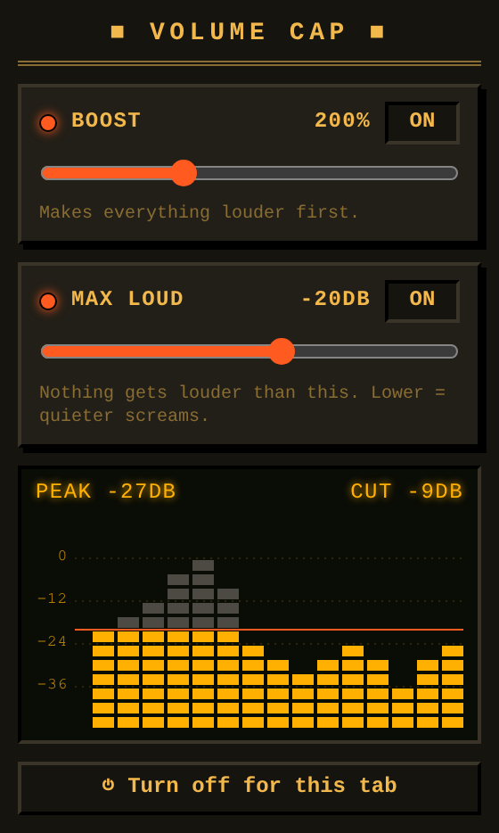

# Volume Cap

[](https://github.com/Nachtalb/volume-cap/actions/workflows/test.yml)
[](LICENSE)
[](https://developer.chrome.com/docs/extensions/develop/migrate/what-is-mv3)
[](manifest.json)
[](https://microsoftedge.microsoft.com/addons/detail/volume-cap/hpajfcdpgmbejnechkkcdjmbpbocibnf)
<!-- Chrome Web Store, once approved:
[](https://chromewebstore.google.com/detail/inhjbllcpbgbpocobddlbcganfhhikdn)
-->

<a href="https://microsoftedge.microsoft.com/addons/detail/volume-cap/hpajfcdpgmbejnechkkcdjmbpbocibnf"></a>
<!-- Chrome Web Store, once approved:
<a href="https://chromewebstore.google.com/detail/inhjbllcpbgbpocobddlbcganfhhikdn"></a>
-->

Boost a tab's volume and cap its peak loudness, so quiet voices are audible
and screams don't blow your ears out. Chrome and Edge.



## Install

Get it from [Microsoft Edge Add-ons](https://microsoftedge.microsoft.com/addons/detail/volume-cap/hpajfcdpgmbejnechkkcdjmbpbocibnf).
<!-- Chrome Web Store, once approved:
Get it from [Microsoft Edge Add-ons](https://microsoftedge.microsoft.com/addons/detail/volume-cap/hpajfcdpgmbejnechkkcdjmbpbocibnf) or the
[Chrome Web Store](https://chromewebstore.google.com/detail/inhjbllcpbgbpocobddlbcganfhhikdn).
-->

Or from source: open `edge://extensions` or `chrome://extensions`, enable
Developer mode, **Load unpacked** and pick this folder.

## Use

Click the icon on a tab. **Boost** turns it up, **Max loudness** is the
ceiling nothing gets past. The graph shows the last few seconds; grey is what
got cut.

## Development

```sh
bun test
uv run tools/make-icons.py  # regenerate icons/
```
